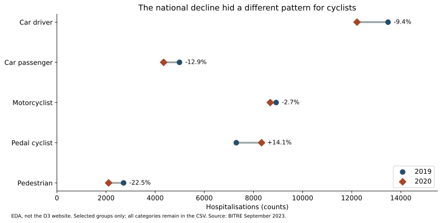
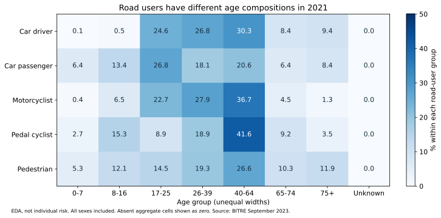

# EDA findings and story decisions

Updated: 21 November 2026

We extended our first analysis after the Stand Up 1 feedback. The new work profiles the unused fields and tests whether the national total hides useful contrasts between road users. This is an analysis checkpoint, not a completed D3 redesign or usability evaluation.

## Data and reproduction

Source: `data/raw/hospitalisation_injury_publication_sep2023.xlsx`, sheet `raw`. Filter: `Cause of injury = Traffic`. Measure: sum of `Hospitalisations`. Raw rows are aggregated records, not unique patients or crashes. We retained unknown categories and recorded zeros, and did not edit the raw workbook or the three existing website CSVs.

The workbook SHA-256 is `28de6080801cb77b6867a5db2011cfc382abcbd6ffc467a2f96487b27b99c19e`. We keep this September 2023 release separate from revised figures on the live dashboard.

Run from the repository root, in CMD or PowerShell:

```text
py tools/explore_data.py
py -m unittest discover -s tools -p "test_explore_data.py" -v
py tools/verify_data.py
npm test
```

The audit uses Python's standard library and the existing workbook reader. `py tools/explore_data.py --plots` also regenerates the two EDA figures when Matplotlib and NumPy are installed. Plotting libraries are not required by the website or the core audit.

## Audit results

| Check | Result |
| --- | --- |
| Source records | 117,919 |
| Traffic records retained | 86,140 |
| Duplicate Traffic dimension keys | 0 |
| Published T1 annual controls | 11/11 match |
| Published T2 road-user/year controls | 132/132 match; the separate Total column is also checked |
| Published T4 remoteness/year controls | 44/44 match |
| New monthly, counterparty and age aggregations | Each reconciles to all 132 road-user/year totals |

[audit.json](../data/analysis/audit.json) contains types, categories, ranges, zero counts and blank counts for all 13 fields, for both the full source and Traffic subset, plus per-year measure missingness.

| Field | Type and Traffic coverage | Processing decision |
| --- | --- | --- |
| Calendar year | Integer, 2011-2021 | Mark the 2012 and 2017 recording breaks |
| Month | 12 categories | Order chronologically; separation reporting dates do not necessarily identify crash dates |
| ABS remoteness area | Four categories, including Missing | Describes usual residence, not crash location |
| Cause of injury | Traffic after filtering; six categories in the full source | Keep this scope consistent across all comparisons |
| Age group | Eight categories, including Missing | Retain Unknown; age bands have unequal widths |
| Sex | Three source categories | Retain the combined intersex/indeterminate/missing category |
| Road user | 12 Traffic categories | Keep all in the data and disclose any display subset |
| Counterparty | 10 Traffic categories | Keep literal categories; non-collision and unspecified are different |
| Count of cases | Integer where recorded; 4,578 blanks | Preserve blanks; do not substitute this for Hospitalisations |
| Bed days | Positive integers in every Traffic row | Retain transfer-related rows without an additional counted case |
| Died_cases | 84,142 blanks | A blank is not a zero-death observation |
| Died_bed_days | 83,854 blanks | Do not silently impute zero for a new burden measure |
| Hospitalisations | Complete integers; 4,899 zeros | Use the supplied measure and verify against published controls |

All 7,811 Traffic records in 2021 have blank `Died_cases` and `Died_bed_days`. There are also 4,899 Traffic records with zero Hospitalisations and positive Bed days. These rows remain in our analysis. The dictionary explains that transfers can contribute bed days without an additional counted case.

The script checks parity with the workbook arithmetic `Hospitalisations = Count of cases - Died_cases`, where blank operands contribute zero to that arithmetic. This does not make blank death fields observed zeros. We withhold death trends and death-adjusted bed-day ratios until missingness, transfer attribution and numerator scope are resolved. Averaging ratios calculated row by row would be inappropriate.

## Finding 1: a national decline did not describe every road user

| Group | 2019 | 2020 | Difference | Change |
| --- | --- | --- | --- | --- |
| All road users | 39,866 | 37,966 | -1,900 | -4.8% |
| Car driver | 13,482 | 12,217 | -1,265 | -9.4% |
| Car passenger | 4,989 | 4,344 | -645 | -12.9% |
| Motorcyclist | 8,924 | 8,684 | -240 | -2.7% |
| Pedal cyclist | 7,302 | 8,332 | +1,030 | +14.1% |
| Pedestrian | 2,713 | 2,103 | -610 | -22.5% |

The full [change table](../data/analysis/road_user_changes_2019_2020.csv) retains all 12 road-user categories. Cyclists were not the only category to increase: pick-up truck or van occupants rose from 260 to 300 (+15.4%). We highlight cyclists for the much larger absolute increase, not because their percentage increase was the largest.

This adjacent-year comparison avoids crossing the known 2012 or 2017 admission-policy breaks. It does not establish complete comparability or causation. We cannot conclude that cycling became riskier or that COVID caused the change without appropriate denominators and contextual evidence.



This static EDA figure shows five named groups for readability. It is supporting analysis, not a screenshot of the D3 website.

## Finding 2: counterparty patterns differ between road users

| Selection in 2021 | Hospitalisations | Share within that road user |
| --- | --- | --- |
| Cyclists: Non-collision transport accident | 3,705 | 45.4% of 8,163 |
| Cyclists: Car, pick-up truck or van | 1,575 | 19.3% of 8,163 |
| Cyclists: Other and unspecified transport accidents | 1,854 | 22.7% of 8,163 |
| Motorcyclists: Non-collision transport accident | 3,759 | 42.3% of 8,883 |
| Pedestrians: Car, pick-up truck or van | 2,063 | 88.4% of 2,334 |

Source: [counterparty summary](../data/analysis/counterparty_by_road_user.csv). The denominator includes every recorded counterparty for the road-user/year selection, including unspecified categories. These are hospitalisations, not counts of collision events. Counterparty does not identify fault, and unspecified events cannot be reclassified as either collisions or non-collisions without evidence.

## Finding 3: the age profile depends on the road-user group

| Road user, 2021 | Largest recorded age group | Hospitalisations | Share within that road user |
| --- | --- | --- | --- |
| Pedal cyclist | 40-64 | 3,393 | 41.6% |
| Motorcyclist | 40-64 | 3,259 | 36.7% |
| Car driver | 40-64 | 4,036 | 30.3% |
| Pedestrian | 40-64 | 622 | 26.6% |
| Car passenger | 17-25 | 1,203 | 26.8% |

Source: [age summary](../data/analysis/age_by_road_user.csv). These totals include all three source sex categories. Percentages describe age composition within each road user, not age-specific population risk. The unequal age-band widths must remain visible in the explanation.



The heatmap uses within-road-user percentages so that large groups do not dominate solely through their size. Exact counts remain in the CSV. Absent aggregate keys are shown as zero in this labelled EDA figure; blank raw measures must not be silently turned into observed zeros in future chart code.

## Supporting findings kept outside the main story

- National April Hospitalisations fell from 3,488 in 2019 to 2,357 in 2020, about -32.4%. [Monthly summaries](../data/analysis/monthly_by_road_user.csv) support further investigation, but this is not proof of a lockdown effect.
- In 2021, remoteness counts were 26,355 for Major Cities, 11,407 for Regional, 1,114 for Remote and 629 for Missing. The [remoteness summary](../data/analysis/remoteness_by_year.csv) reconciles to 39,505. Without suitable denominators, it cannot rank individual risk or locate crashes.
- Bed-day burden remains a research branch. We will use age composition for the third chapter rather than promise an unverified burden result.

## Scope, rubric and remaining work

Verification on 21 November: 9/9 Python EDA tests and 6/6 existing JavaScript data tests passed. The original raw-data/website-export reconciliation passed. Both EDA figures were visually reviewed; document links, source hash and reported missingness figures were checked. This does not constitute browser interaction testing or a participant evaluation of the proposed design.

The new CSVs contain observed aggregate keys, including observed keys summing to zero. They are Python-derived exploratory evidence, not yet KNIME-regenerated exports or website inputs. Before using them in the final visualisation, extend KNIME, reconcile its outputs and include all used data and exports in the submitted workflow.

The final assessment PDF in `docs/design_book` assigns 5 points to Data Processing and Exploration, 10 to Visualisation Design, 5 to Interaction Design, 5 to Complexity and 5 to Storytelling. This checkpoint supports systematic EDA and the question/evidence chain. It does not complete the design, implementation or evaluation criteria.

The Excellent complexity descriptor also discusses meaningful integration of multiple datasets. Our CSVs are transformations of one national source workbook; we will not describe them as independent sources. Additional integration needs a justified analytical purpose.

The [storyboard](STORYBOARD.md) links the first three findings into a narrative. On 22 November we added [wireframes and chart sketches](design/preview.html), the three [Week 11 design drafts](design_book/03_design_draft.md) and a [coding plan](CODING_PLAN.md). The deck and merged Design Book remain to be prepared. New D3 code, KNIME desktop execution and participant testing are not claimed here.

## References

Bureau of Infrastructure and Transport Research Economics. (2023). *Hospitalised injury* [Data set]. https://www.bitre.gov.au/resource/road-safety/hospitalised-injury

Road Safety Data Hub. (2023). *Hospitalised injuries from road crashes: Data dictionary, September 2023*. https://www.bitre.gov.au/sites/default/files/documents/hospitalised-injury-data-dictionary-september-2023.pdf
