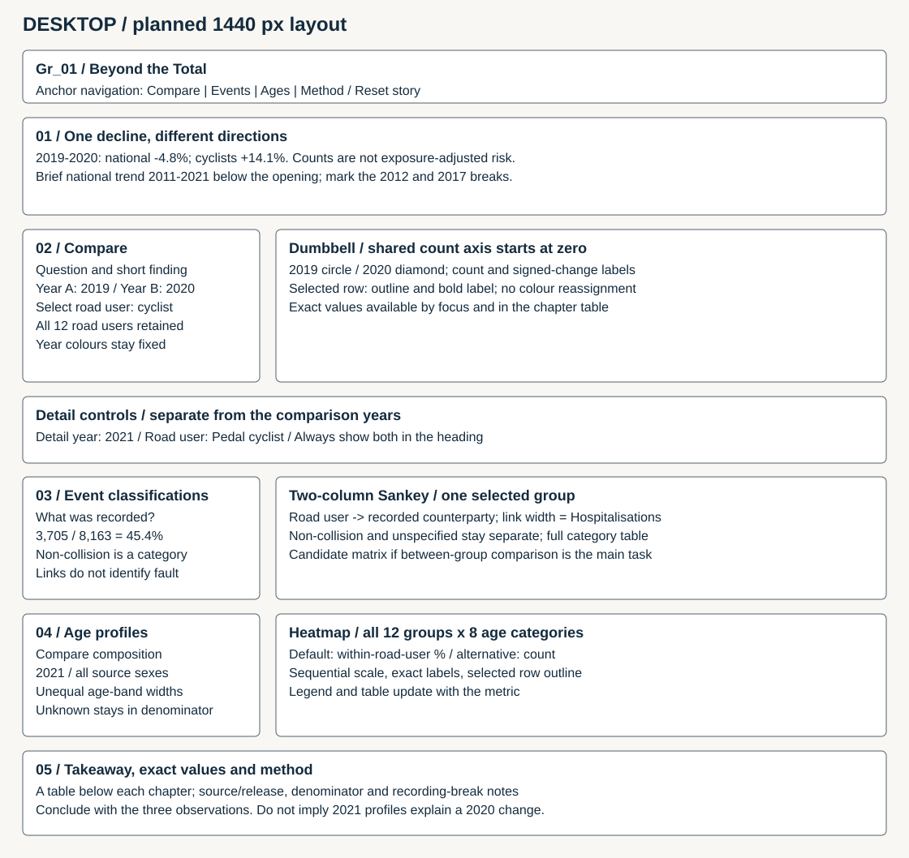
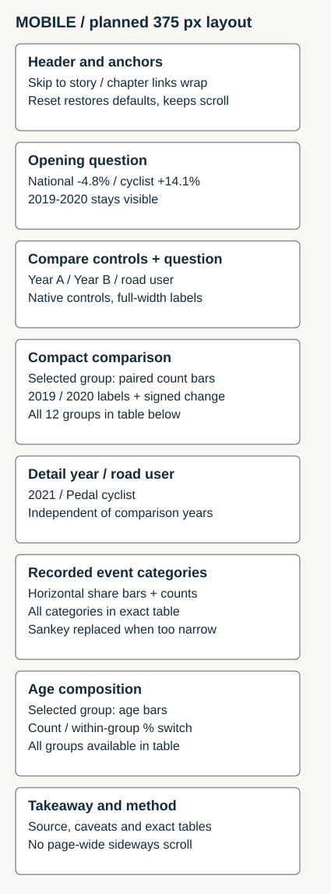
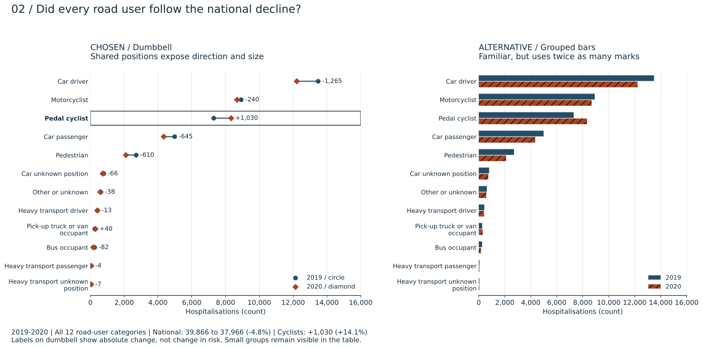
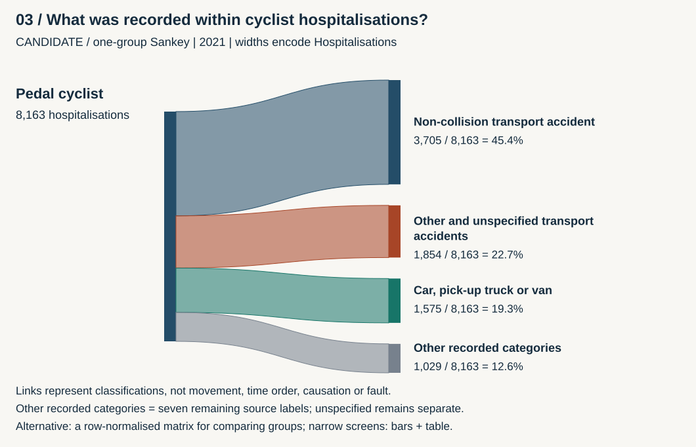
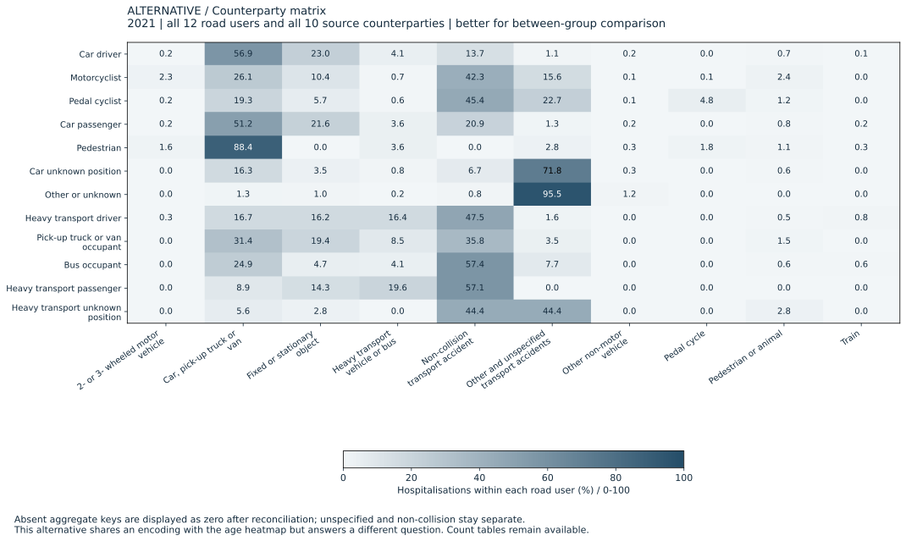
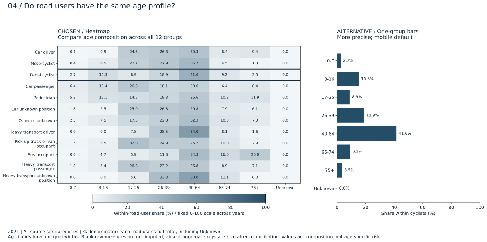

# Beyond the Total

## Different Stories Behind Australia's Road Injuries

Project Design Book draft for Stand Up 2, 23 November 2026.

Team Gr_01: Nguyen Huyen Minh Nhat and Le Tuan Huy.

Prepared: 22 November 2026. Presenter: Le Tuan Huy.

This draft documents the existing pipeline and website, the deeper exploration following Stand Up 1, and our proposed design for the next implementation. The revised chart code and participant evaluation are the next milestones.

## 1 Introduction

### 1.1 Background and motivation

We explore Australian road-crash hospitalisations for students and general readers interested in road safety. A national total is useful context, but it can hide differences between road-user groups. Our first stand-up used linked trend, ranking and demographic charts. Following feedback, we developed a more focused story around the question: what differences disappear when road injuries are reduced to one national total?

Readers will compare changes across groups, inspect recorded event classifications and compare age composition. The purpose is to describe hospitalisation counts and composition while making their limits clear. The dataset has no compatible exposure denominator for ranking individual risk.

### 1.2 Visualisation purpose

Our revised questions are:

1. Did all road users follow the national decline in 2019-2020?
2. Which counterparties and event classifications make up a selected road-user total?
3. How does age composition differ across road-user groups?

The initial detail profiles use 2021, the latest year in this workbook. They answer a different question from the two-year comparison. We will not imply that a 2021 classification caused a change in 2020. The story moves from the opening contrast to comparison, event composition, age profiles and a takeaway with exact tables and method notes.

## 2 Data

### 2.1 Source and governance

The primary source is BITRE's September 2023 hospitalised injury workbook, based on AIHW National Hospital Morbidity Database data. We use the `raw` worksheet of `hospitalisation_injury_publication_sep2023.xlsx`. It contains 117,919 aggregated records across six cause categories. Filtering `Cause of injury = Traffic` retains 86,140 records.

| Item | Scope and treatment |
| --- | --- |
| Coverage | Australia, calendar years 2011-2021 |
| Measure | Sum of Hospitalisations, not a count of rows |
| Main dimensions | Year, road user, age group, sex and counterparty |
| Retained categories | All 12 Traffic road users, Unknown age and the combined other/missing sex category |
| Privacy | Grouped administrative counts without direct patient identifiers |
| Source preservation | Original workbook unchanged. Analysis and exported summaries are separate files |

Hospitalisations are events rather than necessarily unique people or crashes. The dictionary identifies recording changes in Victoria from 2012 and NSW from June 2017. These affect interpretation of the national trend. Age bands have unequal widths. Remoteness describes usual residence, not crash location. Counterparty does not identify fault. We identify the source release and avoid mixing these figures with later revisions on a live dashboard. A workbook-specific open licence has not been confirmed.

### 2.2 Processing and analysis

The current KNIME pipeline has 10 nodes. Excel Reader loads the raw sheet, Row Filter retains Traffic, Column Filter keeps required fields, and Column Renamer sets consistent export names. Three GroupBy/CSV Writer branches sum Hospitalisations into annual, road-user and age/sex outputs.

| Export | Grouping | Rows |
| --- | --- | --- |
| annual_totals.csv | Year | 11 |
| road_user_by_year.csv | Year and road user | 132 |
| age_sex_by_road_user.csv | Year, road user, age group and sex | 1,683 |

The workflow figure represents the current three-output pipeline. The Stand Up 2 package relabels it for Gr_01 and retains bundled source data, outputs and saved node data. We have not added a Counterparty branch in this checkpoint. Desktop re-import and execution on the presentation laptop remain to be checked.

| Attribute | Type and processing decision |
| --- | --- |
| Calendar year | Integer. Order chronologically and mark recording breaks |
| Road user and Counterparty | Nominal categories. Retain literal labels and disclose display grouping |
| Age group | Ordered categories, including Missing displayed as Unknown |
| Sex | Nominal categories. Preserve the combined intersex/indeterminate/missing category |
| Hospitalisations | Complete nonnegative integer measure. Sum it across the selected dimensions |
| Count of cases, Died_cases and Died_bed_days | Nullable measures. Preserve missingness and do not reinterpret blanks as observed zeros |
| Bed days | Additive bed-day count with transfer-related records. No unverified severity ratio |

The Python exploration profiles all 13 source fields and derives monthly, counterparty, age and remoteness reference summaries. These are exploratory outputs from one workbook. They are not independent datasets or completed new KNIME exports. Before production use, the Counterparty branch must retain that field, group by year/road user/counterparty, and reconcile every total against the existing road-user data.

Checks match 11 annual T1 controls, 132 road-user/year T2 controls and 44 remoteness/year T4 controls. Monthly, counterparty and age summaries each reconcile to all 132 road-user/year totals. The current processed CSVs and website copies also agree. The audit found no duplicate Traffic dimension keys. Existing checks record 9 Python EDA tests and 6 JavaScript data tests passing. These are technical checks, not usability results.

We retain zero-Hospitalisation rows and explicit unknown categories. All 7,811 Traffic records in 2021 have blank death fields. Across Traffic data, 4,899 records have zero Hospitalisations and positive Bed days. Transfer-related care can add bed days without another counted case. We therefore withhold death trends and death-adjusted bed-day ratios until the numerator and missingness definitions are resolved.

### 2.3 Exploration and story decisions

| Finding | Calculation and interpretation |
| --- | --- |
| National decline, cyclist increase | 2019-2020: 39,866 to 37,966 nationally (-4.8%), while cyclists rise 7,302 to 8,332 (+14.1%) |
| Different event classifications | Cyclists in 2021: Non-collision transport accident 3,705 / 8,163 = 45.4%. Car/pick-up/van 1,575 / 8,163 = 19.3% |
| Different age profiles | Cyclists aged 40-64 in 2021: 3,393 / 8,163 = 41.6%. Car passengers' largest group is 17-25: 1,203 / 4,495 = 26.8% |

Cyclists are not the only increasing category. Pick-up/van occupants rise from 260 to 300 (+15.4%), but the cyclist absolute increase is much larger. Percentage change uses the first-year count as its baseline. Age and counterparty percentages use the full selected road-user/year total, with retained unknowns and unspecified categories. We make no claim that COVID caused the contrast or that counts establish risk.

Monthly and remoteness findings remain supporting exploration. They do not add filters to the main story without a reader task that justifies them. The full analysis, audit and reference CSVs are in `docs/EDA_AND_STORY.md` and `data/analysis`.

## 3 Visualisation Design

### 3.1 Website Design

Our revised question is: what differences disappear when road injuries are reduced to one national total? We are designing for students and general readers who need a guided explanation before exploring the data. The [storyboard](../STORYBOARD.md) connects three verified observations, rather than treating every field as a separate dashboard filter.

The opening contrasts the national decline of 4.8% in 2019-2020 with the 14.1% increase for cyclists. Readers then compare road users, inspect recorded event classifications and compare age composition. We use 2021 for the initial detail profiles because it is the latest year in this workbook. These profiles answer a different question from the 2019-2020 comparison; they do not explain its cause.

The desktop layout places a short question and finding beside each chart. Chapter links lead to Compare, Events, Ages and Method. A brief national trend provides 2011-2021 context with the 2012 and 2017 recording breaks marked. Comparison-year controls belong to the comparison chapter; detail-year and road-user controls precede the two profile chapters. Each chapter has its own exact-value table, caption and source note.

We retain the current website's warm paper background, navy/rust accents, serif headings and sans-serif body text. A maximum content width of 1,200 px limits long lines, and body text starts at 16 px. Short paragraphs explain what to look for and what a result cannot establish. The design uses familiar headings and native controls rather than adding decorative animation.

Below 740 px, explanations and controls stack above the chart. The comparison uses paired bars for the selected group with the full comparison table below. The event view uses labelled horizontal bars instead of compressing Sankey labels. The age view uses selected-group bars, with all groups accessible through the table and selector. These alternatives keep labels readable; they still need implementation and device checks. The page should reflow without page-wide horizontal scrolling. A wide exact-value table may have its own labelled scroll container.

The [review page](../design/preview.html) collects the sketches for inspection. Its wide chart figures can be scrolled on a narrow screen because they are design evidence, not the proposed mobile interface.

### 3.2 Visualisation Design

All views use the September 2023 workbook, `Cause of injury = Traffic`, and summed `Hospitalisations`. A raw row is an aggregated record. The [EDA report](../EDA_AND_STORY.md) documents source controls and limitations. Our design retains all 12 road-user categories, explicit unknowns and recorded zeros. Counts and within-group percentages do not measure exposure-adjusted risk.

#### Comparing two years: dumbbell

The dumbbell assigns one row to each road-user group. Two positions on a shared count axis represent the selected years, joined by a segment. We start the axis at zero, keep a consistent scale within the comparison, and label the signed absolute change. The table supplies both counts, absolute change and percentage change. If the first year's count is zero, percentage change is undefined and displays as not available rather than infinity.

The initial pair is 2019 and 2020. The national count changes from 39,866 to 37,966, while cyclists change from 7,302 to 8,332. Cyclists are not the only increasing category: pick-up/van occupants increase from 260 to 300. We focus on cyclists because the absolute increase is much larger, not because it is the largest percentage increase.

Grouped bars are a useful alternative because readers recognise them readily. The dumbbell requires fewer marks and makes the connection between two observations explicit. Its limitations are reduced familiarity and the difficulty of seeing small differences beside large groups. Exact labels and tables address precision; the full-series trend provides context that a two-year chart cannot show.

#### Recorded event categories: Sankey candidate

The two-column Sankey connects one selected road-user total to its recorded counterparties. Link width represents Hospitalisations. This focuses on composition without the crossings produced by showing every road user at once. For cyclists in 2021, Non-collision transport accident accounts for 3,705 of 8,163 hospitalisations (45.4%), compared with 1,575 (19.3%) classified as Car, pick-up truck or van.

The compact sketch keeps three source categories separate and groups the remainder. The production table will retain the full domain, with a disclosed display mapping:

| Display label | Literal source labels |
| --- | --- |
| Non-collision transport accident | Non-collision transport accident |
| Other and unspecified transport accidents | Other and unspecified transport accidents |
| Car, pick-up truck or van | Car, pick-up truck or van |
| Other recorded categories | Fixed or stationary object; Pedal cycle; Pedestrian or animal; Heavy transport vehicle or bus; 2- or 3- wheeled motor vehicle; Other non-motor vehicle; Train |

The remainder is 1,029 for the default selection. It is not the same category as Other and unspecified transport accidents. Every source label belongs to exactly one display group. The mapping stays fixed across selections; zero-width links do not remove labels from the table. Source and target totals must agree.

A matrix with road users as rows, counterparties as columns and within-road-user percentage as colour makes between-group comparison easier. It also retains all ten source categories without grouping. We will test whether tracing the Sankey helps readers enough to justify its space; the matrix is the fallback if the task favours comparing groups. On narrow screens, bars and the exact table provide a simpler composition view. Sankey links are category associations, not patient movement, time order, cause or fault. Unspecified classifications cannot be assigned to collision or non-collision without evidence.

#### Age profiles: heatmap

The heatmap uses road-user rows and eight ordered age columns. A sequential light-to-dark blue scale represents within-road-user percentage by default. Each denominator includes all age categories, including Unknown, and all source sex categories. For cyclists in 2021, the 40-64 group contributes 3,393 of 8,163 hospitalisations (41.6%). Car passengers have a different profile: their largest recorded group is 17-25, with 1,203 of 4,495 (26.8%).

The percentage domain stays at 0-100 across years; count mode uses a single maximum across the complete age dataset, so switching year does not silently rescale colour. The metric name, legend, exact values and table change together. A selected row receives an outline and bold label without recolouring its cells. Percentages are computed from counts before display rounding.

Single-group bars offer more precise position-based comparison and are the mobile default. A heatmap is more compact for comparing profiles across all groups but is less precise, so focus details and a table remain necessary. Unequal age-band widths are stated beside the chart. Equal-width cells are categorical columns, not equal intervals of age or a distribution of individual risk.

#### Colour, labels and accessibility

| Element | Proposed encoding | Additional cue |
| --- | --- | --- |
| First comparison year | Navy `#244d68` | Circle and explicit year label |
| Second comparison year | Rust `#a74527` | Diamond and explicit year label |
| Selected road user | Dark outline and bold row label | Selection also named in controls and caption |
| Heatmap magnitude | Sequential blue, one metric at a time | Exact values, labelled legend and table |
| Sankey categories | Fixed categorical colours | Literal category names, count and share labels |

Colour is accompanied by shape, labels or exact values, following W3C guidance on use of colour (W3C, n.d.-b). We plan text contrast checks and at least 3:1 contrast for meaningful control and graphic boundaries where required (W3C, n.d.-a). This is a design target, not a claim that the unimplemented interface passes WCAG.

The interface will expose the same exact values on keyboard focus as on hover. Native labelled selectors provide an alternative to selecting a chart mark. Touch selection will not depend on hover. SVG views need a short accessible name and description, with structured tables for the full data. Motion will be brief, nonessential and removed when reduced motion is requested. Zooming and animation are omitted because they do not yet solve a reader task in this story.

### 3.3 Interaction Design

We keep one shared road-user selection, but separate the comparison pair from the detail year. Changing a profile must not silently change the historical comparison. The proposed initial state is comparison 2019/2020, detail year 2021, Pedal cyclist, age percentage mode and no focused counterparty.

| Method and trigger | Expected response | Purpose and boundary |
| --- | --- | --- |
| Open the story | Show the documented default state and all year labels | Begin with the verified contrast |
| Choose either comparison year | Update comparison marks, national contrast, change labels and comparison table | Require first year before second year; warn if the interval crosses 2012 or 2017; do not change profiles |
| Choose a road user or activate its comparison/heatmap row | Outline that row and update event composition, mobile age bars, captions and detail tables | Follow one group; preserve year colours and quantitative cell fills |
| Choose the detail year | Update event and age profiles and their tables | Leave comparison years unchanged |
| Focus or hover a mark | Show exact years/counts and any percentage denominator; clear transient detail on Escape or loss of focus | Support precise reading without changing selection |
| Activate a counterparty link, node or its table control | Highlight that category and name its count/share | Highlight only; do not filter age data or suggest causal linkage |
| Switch age count / within-group percentage | Update cells or bars, legend, caption and age table | Separate total size from composition |
| Activate Reset story | Restore documented defaults and clear category focus | Keep current scroll position; chapter navigation handles movement |
| Use a chapter anchor or Skip to story | Move focus to the requested section | Preserve the current data selections |

An invalid year pair is prevented or explained beside the controls before rendering. Zero-total groups have no defined composition percentage and receive a text explanation and count table. Missing files or malformed data produce a clear unavailable state, not partially updated charts. When the road user or detail year changes, category focus clears to avoid retaining an irrelevant highlight.

Implementation and testing follow the [coding plan](../CODING_PLAN.md). Week 12 evaluation will check whether readers distinguish comparison years from profile years, interpret the event categories correctly, understand the percentage denominator and recover with Reset. We have not collected participant results yet.

## 4 Iteration and Validation

### 4.1 Current iteration

The first stand-up feedback asked for deeper dataset questions, clearer storytelling and more ambitious visualisation choices. We responded with a field audit and a revised question/evidence sequence. The existing line/ranking/demographic implementation now has proposed dumbbell, age heatmap and counterparty composition alternatives. The sketches and interaction specification are the evidence for this design iteration. The new charts still need D3 implementation.

### 4.2 Next evaluation

For Week 12 we plan to ask readers to find a group that increased against the national decline, identify the cyclist non-collision share, explain an age percentage denominator and recover the defaults. We will record task success, approximate time and misunderstandings, then document any changes with before/after evidence. We will also check keyboard use, exact-value tables and narrow layouts. Participant recruitment, results and refinements are pending.

## 5 Progress and next steps

The current workflow and linked website are available. The deeper audit, storyboard, wireframes, labelled chart alternatives and three required design sections are drafted. Huy helped build the website and tutorial-based charts and practised running the basic workflow. Individual contribution accounts should refer to work each member actually performed.

Next, we will reconcile the additional KNIME export, implement the dumbbell and age view, and evaluate the event composition design. Week 12 will demonstrate actual charts and interactions with an updated Iteration and Validation section. The final project will incorporate the resulting refinements and a complete Design Book.

## References

Bureau of Infrastructure and Transport Research Economics. (2023). *Hospitalised injury* [Data set, September 2023 release]. https://www.bitre.gov.au/resource/road-safety/hospitalised-injury

Road Safety Data Hub. (2023). *Hospitalised injuries from road crashes: Data dictionary, September 2023*. https://www.bitre.gov.au/sites/default/files/documents/hospitalised-injury-data-dictionary-september-2023.pdf

Observable. (n.d.). *Joining data*. D3. Retrieved November 22, 2026, from https://d3js.org/d3-selection/joining

World Wide Web Consortium. (n.d.-a). *Understanding SC 1.4.11: Non-text contrast*. Retrieved November 22, 2026, from https://www.w3.org/WAI/WCAG22/Understanding/non-text-contrast

World Wide Web Consortium. (n.d.-b). *Understanding SC 1.4.1: Use of color*. Retrieved November 22, 2026, from https://www.w3.org/WAI/WCAG22/Understanding/use-of-color

## Appendix - AI declaration

We used AI assistance for workflow configuration, the existing D3 implementation, data validation, exploratory analysis and draft design/presentation materials. Prompt summaries remain in source comments and workflow annotations. We checked counts against source controls and reviewed the design evidence. Both members must understand and explain the work in their own words. We do not claim participant evaluation, KNIME desktop execution of the renamed package or implemented new interactions that have not taken place.
